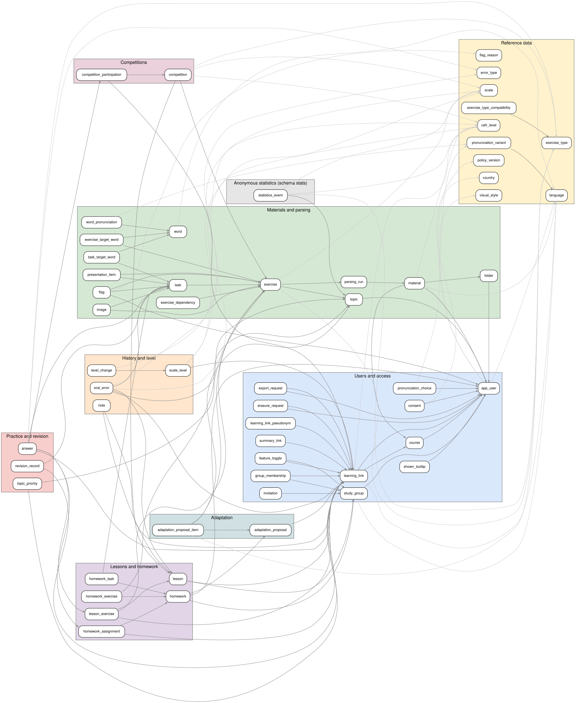
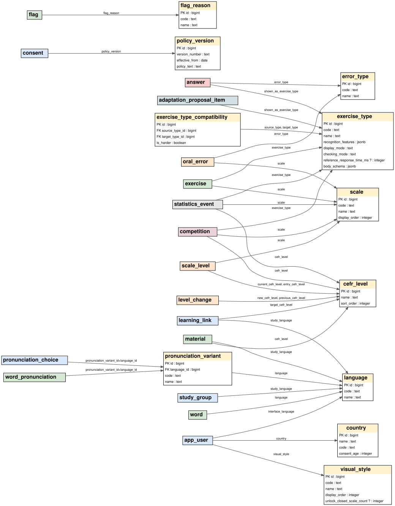
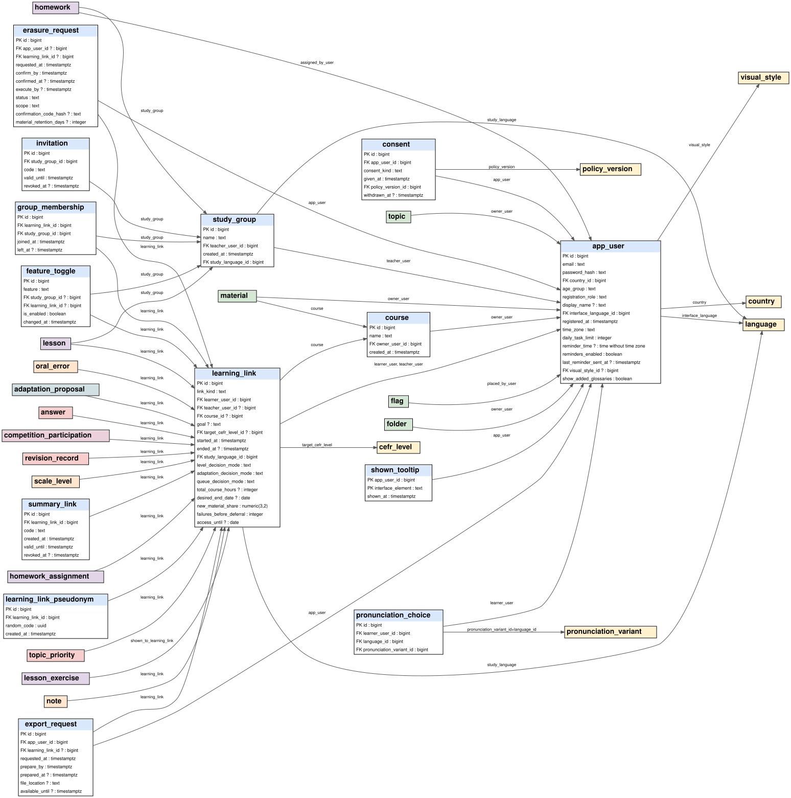
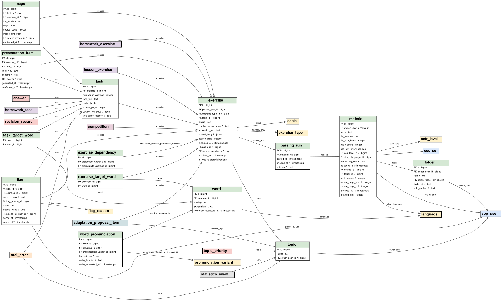
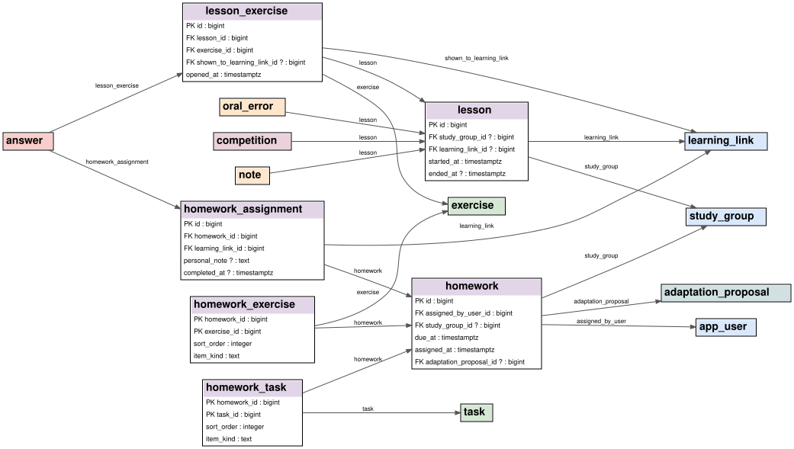
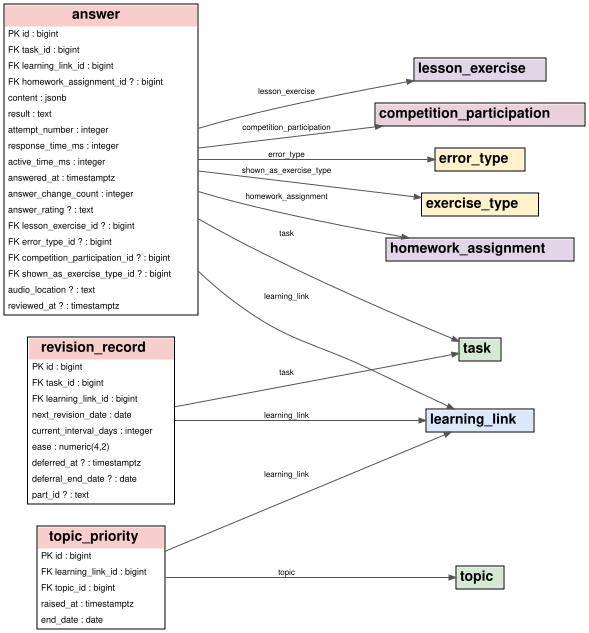
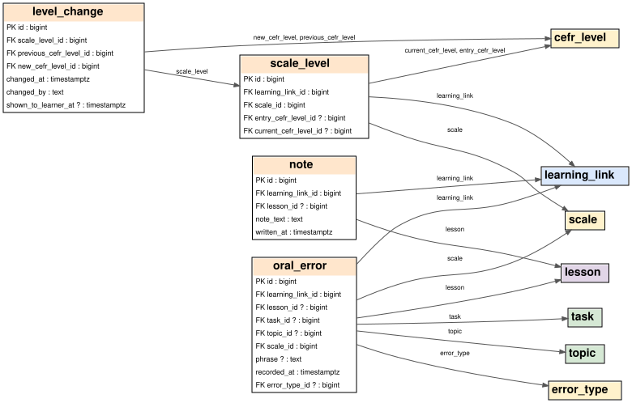
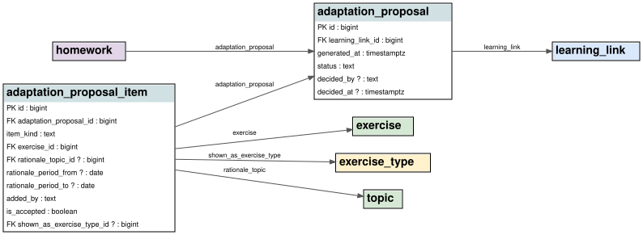
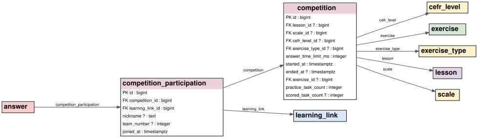
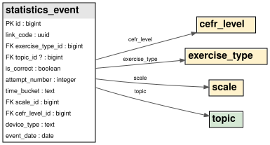

# Logical schema

The diagrams are generated from the database catalogue after all migrations, so they show the database as it is. An arrow goes from the table that holds a foreign key to the table it refers to.

## Overview

All 57 tables are grouped into nine blocks. A block is a group of tables that serve one part of the product, and its colour is the same in every diagram below. Each box lists the tables of the block. An arrow from one block to another means that tables of the first refer to tables of the second, and the number on the arrow says how many foreign keys do so. Arrows to the reference data are drawn in light grey so that the main structure stays visible. The relationships between individual tables are shown in the diagrams of the blocks further down.

| Colour | Block | Tables | What it holds |
|---|---|---|---|
| `#FFF2CC` | Reference data | 11 | Fixed lists filled by migrations. The application only reads them. |
| `#DAE8FC` | Users and access | 14 | Accounts, consents, groups and the learning link: the pair of a learner and a teacher, or a learner and their own course. Almost everything a learner does hangs on a learning link. |
| `#D5E8D4` | Materials and parsing | 14 | Uploaded PDF materials and what parsing produced from them: exercises, their tasks, flags on doubtful places, images and words. |
| `#E1D5E7` | Lessons and homework | 6 | What a teacher shows in a lesson and assigns as homework. |
| `#F8CECC` | Practice and revision | 3 | Answers of learners and the state of spaced repetition. |
| `#FFE6CC` | History and level | 4 | The level of a learner on four scales, its changes, errors noticed in speech and notes of the teacher. |
| `#D0E0E3` | Adaptation | 2 | What the system proposes to give next, to make harder or to return to revision. |
| `#EAD1DC` | Competitions | 2 | Competitions in a lesson and between learners of the same level. |
| `#E6E6E6` | Anonymous statistics (schema stats) | 1 | Events without personal data, linked to a learning link only through a random code. |

## How to read the block diagrams

- Each diagram shows the tables of one block with all their columns. Tables of other blocks that are connected to it are shown as a name only, in the colour of their own block.
- `PK` marks the primary key, `FK` a foreign key column, `?` a column that may be empty.
- The label on an arrow is the foreign key column without `_id`.
- Types, constraints and descriptions of every column are in [data-dictionary.md](data-dictionary.md).

## Main relationships

| Kind | Example | How it is stored |
|---|---|---|
| One to many | `material` → `parsing_run` → `exercise` → `task` → `answer` | A foreign key in the child table |
| Many to many, plain pair | `homework` and `exercise` through `homework_exercise`; `task` and `word` through `task_target_word` | A link table whose primary key is the pair of foreign keys |
| Many to many with history | `learning_link` and `study_group` through `group_membership`: a learner may leave a group and come back | A link table with its own `id`, dates and a partial unique index on the open membership |
| One to one | `learning_link` and `course` for a self-directed learner; `learning_link` and `learning_link_pseudonym` | A foreign key with a unique constraint |
| One of two parents | `flag` belongs to a `task` or to an `exercise`; `lesson` belongs to a `study_group` or to a `learning_link` | Two nullable foreign keys and a `CHECK` that exactly one is filled |
| Self-reference | `folder.parent_folder_id`; `exercise.source_exercise_id` | A foreign key to the same table |
| Reference value | `exercise.exercise_type_id`, `scale_level.current_cefr_level_id` | A foreign key to a reference table, `ON DELETE RESTRICT` |
| No relationship on purpose | `stats.statistics_event.link_code` | A plain `uuid`, not a foreign key: this is what makes the statistics anonymous |

## Reference data

Fixed lists filled by migrations. The application only reads them.

## Users and access

Accounts, consents, groups and the learning link: the pair of a learner and a teacher, or a learner and their own course. Almost everything a learner does hangs on a learning link.

## Materials and parsing

Uploaded PDF materials and what parsing produced from them: exercises, their tasks, flags on doubtful places, images and words.

## Lessons and homework

What a teacher shows in a lesson and assigns as homework.

## Practice and revision

Answers of learners and the state of spaced repetition.

## History and level

The level of a learner on four scales, its changes, errors noticed in speech and notes of the teacher.

## Adaptation

What the system proposes to give next, to make harder or to return to revision.

## Competitions

Competitions in a lesson and between learners of the same level.

## Anonymous statistics (schema stats)

Events without personal data, linked to a learning link only through a random code.

